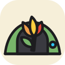

<p align="center">
  
</p>

<h1 align="center">code flower tunnel</h1>

<p align="center">Reach your code flower sandboxes from any browser or phone.</p>

<p align="center">
  <a href="https://github.com/lutrarutra/codeflower-app"> app</a>
  &nbsp;·&nbsp;
  <a href="https://github.com/lutrarutra/codeflower-sandbox"> sandbox</a>
  &nbsp;·&nbsp;
  <a href="https://github.com/lutrarutra/codeflower-vsc-extension"> VS Code extension</a>
  &nbsp;·&nbsp;
  <a href="https://github.com/lutrarutra/storyteller"> storyteller</a>
  &nbsp;·&nbsp;
  <b> tunnel</b>
  &nbsp;·&nbsp;
  <a href="https://docs.codeflower.app">docs.codeflower.app</a>
</p>

The relay between your browser and the code flower app on your machine. It routes end-to-end
encrypted frames it cannot read, so neither a hacked tunnel nor a stolen account alone gives access to
your sandboxes. It runs on Cloudflare Workers (the hosted tunnel) or as one Node process with a SQLite
file (self-hosted).

## Use

```sh
codeflower tunnel pair
```

Run it on the machine with your sandboxes and open the printed link (or QR code) in the browser. It
signs the machine in to the hosted tunnel, keeps the app connected in the background, and pairs the
browser, which then shows every sandbox on the machine. On first sign-in you choose whether the tunnel
passes only through EU datacenters. The app's README lists the
[other `tunnel` commands](https://github.com/lutrarutra/codeflower-app#codeflower-tunnel).
[docs/PROTOCOL.md](docs/PROTOCOL.md) describes what passes between tunnel, connector and browser.

## Self-hosting

```sh
docker build -t codeflower-tunnel .
docker run -d -p 8787:8787 -v codeflower-tunnel:/data \
  -e PUBLIC_URL=https://tunnel.example.org \
  -e COOKIE_SECRET="$(openssl rand -base64 48)" \
  -e GITHUB_CLIENT_ID=… -e GITHUB_CLIENT_SECRET=… \
  codeflower-tunnel
```

Put it behind a reverse proxy that terminates TLS and passes WebSockets through, and point the app at
it with `tunnel: {url: https://tunnel.example.org}` in `~/.codeflower/config.yaml`.

| Variable | |
| --- | --- |
| `PUBLIC_URL` | where browsers reach the tunnel (required) |
| `COOKIE_SECRET` | at least 32 random characters; changing it signs everyone out (required) |
| `TUNNEL_DB` | the SQLite file (required, created if missing; `/data/tunnel.sqlite` in the image) |
| `GITHUB_CLIENT_ID`, `GITHUB_CLIENT_SECRET` | enables GitHub sign-in (callback: `<PUBLIC_URL>/auth/github/callback`) |
| `GOOGLE_CLIENT_ID`, `GOOGLE_CLIENT_SECRET` | enables Google sign-in (callback: `<PUBLIC_URL>/auth/google/callback`) |
| `REQUIRE_GITHUB_2FA` | `false` admits GitHub accounts without two-factor authentication |
| `WEBAUTHN_RP_ID` | the passkeys' domain, if not `PUBLIC_URL`'s host |
| `ALLOWED_IPS` | addresses and CIDR ranges, separated by commas or spaces, e.g. `203.0.113.0/24, 2001:db8::/32`: browsers elsewhere cannot open streams (403). Unset admits all. |
| `CLIENT_IP_HEADER` | behind a reverse proxy, the header it puts the client's address in (`X-Real-IP`, or `X-Forwarded-For`, of which the last address counts). Unset uses the socket's address. Set it only when the proxy overwrites or appends to that header, or clients can forge it. |
| `PORT`, `HOST` | where to listen (8787, all interfaces) |

Passkey sign-in always works. The database migrates itself at startup; back it up with
`sqlite3 tunnel.sqlite ".backup backup.sqlite"`. A self-hosted tunnel is one process and does not
scale out across machines.

## On Cloudflare

The hosted tunnel deploys from this repository with Cloudflare Workers Builds; [docs/DEPLOY.md](docs/DEPLOY.md)
has the one-time setup (CI fields, secrets, OAuth apps). Each connector gets one Durable Object, which
pairs its sockets and stores nothing; EU-only connectors (`eu_…` IDs) get theirs in the EU
jurisdiction. Accounts live in D1.

## Development

```sh
npm install
npm test             # unit tests and the self-hosted server end to end
npm run check        # TypeScript
npm run dev:node     # self-hosted on :8787, database in .dev/
npm run dev:worker   # Cloudflare locally (needs .dev.vars, see below)
```

`.dev.vars` for `wrangler dev`:

```
PUBLIC_URL=http://127.0.0.1:8787
COOKIE_SECRET=dev-secret-dev-secret-dev-secret-00
LOCAL_DEV_WITHOUT_JURISDICTIONS=true
```

Local workerd cannot place Durable Objects in a jurisdiction, hence the last line; never set it in
production. Apply migrations to the local D1 first:
`npx wrangler d1 migrations apply codeflower-tunnel --local`.

**Changing the database**: edit `src/db/schema.ts`, run `npm run db:generate`, then review and commit
the new file in `migrations/`. Cloudflare applies it on `npm run deploy`, a self-hosted tunnel at its
next start.

**Breaking protocol changes**: raise `PROTOCOL` in `src/version.ts` and keep accepting the old
version while possible. To drop a version, first set `DEPRECATED` with a date, so connectors warn
their users; after that date raise `MIN_PROTOCOL`, and older connectors are refused with
`426 upgrade_required`. See "Versioning" in [docs/PROTOCOL.md](docs/PROTOCOL.md).

## License

[AGPL-3.0](LICENSE). If you run a modified tunnel as a service, you must offer its source to its
users. For other terms, get in touch. Contributions need a signed CLA, see
[CONTRIBUTING.md](docs/CONTRIBUTING.md). The connector (codeflower-app) and the browser side
(codeflower-ui) are MIT.
